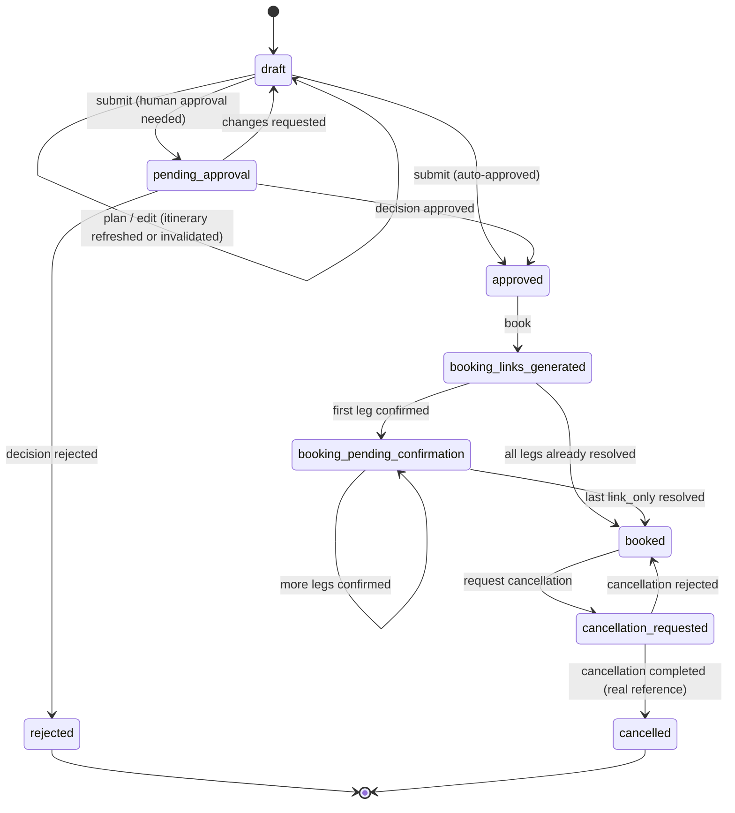

# Travel Agent — Complete Flow & Architecture

> **Snapshot:** Wednesday 04 November 2026, **14:00 IST** (four-role release).
> This document records the code as implemented and verified. See `plan.md §9` and `WORKING.md`
> for the verification evidence.
>
> **Scope of this expansion:** every flow, data point, data flow, state transition, endpoint
> contract, page render path, JSON shape, failure mode and the complete architecture — as the
> system actually runs now, not as intended. Live behaviour was re-verified at the snapshot:
> the database is migrated (all nine tables), the Prisma client is regenerated, the local account
> `rgl@localhost` is an active `super_admin`, and `GET /` redirects to `/admin` (307),
> `/admin` and `/approvals` return 200, `/api/admin/health` and `/api/places/suggest` return 200.

---

## 1. Identity and authorization

### 1.1 Runtime and startup

| Layer | Technology | Version / detail |
|---|---|---|
| Framework | Next.js App Router | `15.0.3` |
| UI | React | `19.0.0-rc` |
| Language | TypeScript | strict, path alias `@/* → ./*` |
| Styling | Tailwind + custom CSS | `tailwindcss 3.4`, `app/globals.css` |
| ORM | Prisma Client | `5.22` |
| Database | SQLite | `DATABASE_URL="file:./dev.db"` → `prisma/dev.db` |
| Validation | Zod | `3.23`, schemas in `lib/validators.ts` |
| LLM | Groq | model from `GROQ_MODEL` (live: `openai/gpt-oss-120b`) |
| Search | Tavily REST | `https://api.tavily.com/search` |
| FX | `open.er-api.com` | 6-hour in-memory cache, static fallback |
| Places | Open-Meteo geocoding | GeoNames records, no key required |
| Cab routing | Google Routes API v2 | **optional**; `GOOGLE_MAPS_API_KEY` is unset live |

Startup sequence: `npm install` → copy `.env.example` to `.env` and fill keys → `npm run setup`
(`prisma db push` + `npm run db:seed`) → `npm run dev` (pinned to port 3000). The seed creates
**only** the env-configured local account and the travel policy — no demo data, ever
(`AGENTS.md`). Schema changes are additive and applied with `prisma db push`; `npx tsc --noEmit`
and `npx next build` are the acceptance checks. Never run two dev servers against one `.next`
directory (stale route manifests cause 404s); use `NEXT_DIST_DIR` for isolated verification.

### 1.2 `getCurrentUser()` — the entire auth system

```ts
const email = process.env.DEV_USER_EMAIL?.trim();
if (!email) throw new ApiError(500, "DEV_USER_EMAIL is required…", { code: "IDENTITY_NOT_CONFIGURED" });
const user = await db.user.findUnique({ where: { email } });
if (!user) throw new ApiError(500, `DEV_USER_EMAIL=${email} not found. Run \`npm run db:seed\`…`,
                                  { code: "IDENTITY_NOT_FOUND" });
if (!user.active) throw new ApiError(403, "This account is deactivated. Ask a super admin…",
                                     { code: "ACCOUNT_INACTIVE" });
return user;
```

Consequences:

- Identity is **global to the server process**, not per browser: every visitor is the same
  account until `.env` changes and the server restarts.
- There is no login, session, cookie, token, password, OAuth or SSO. The browser never supplies
  an identity or a role; the role lives in the `User` row and is re-read on every request.
- A deactivated account is refused at the API with `403 ACCOUNT_INACTIVE`; a missing account is a
  `500` telling you to run the seed. Errors surface as JSON on API routes and as the Next error
  page on pages (pages are not wrapped).
- **Repair note (historical):** during the rewrite the database, generated client and code were
  briefly on different revisions, which made every page 500 and every API 403 with
  `ACCOUNT_INACTIVE`. The fix applied was `prisma db push` + `prisma generate`; the live system
  now passes this gate (verified above). If the symptom returns, check the DB tables and the
  generated client before touching `lib/auth.ts`.

### 1.3 Roles and predicates

Roles: `employee`, `manager`, `travel_admin`, `super_admin` (`lib/auth.ts`, mirrored for labels
in `lib/roles.ts`).

| Helper | Passes for | Used by |
|---|---|---|
| `isApprover` | manager, travel_admin, super_admin | approvals list/decision, team, manager APIs |
| `canViewAllTrips` | travel_admin, super_admin | trip scope, plan/book/cancel for others, policy GET |
| `canApproveAny` | travel_admin, super_admin | decide any approval, reassign, comment on any thread |
| `canHandleBookings` | travel_admin, super_admin | confirm-booking, cancellation review/queue |
| `canViewReports` | travel_admin, super_admin | `/admin/reports`, `/api/admin/reports` |
| `canAssignManagers` | travel_admin, super_admin | `GET /api/admin/users`, `/admin/employees` |
| `canManageUsers` | super_admin | create/update accounts |
| `canConfigurePolicy` | super_admin | `PATCH /api/admin/policy` |
| `canViewAudit` | super_admin | audit log, system health |
| `isRole` | any of the four strings | sidebar role mapping, profile labels |
| `assertRole` / `hasRole` | generic list check | internal building blocks |

### 1.4 Effective permission matrix

| Capability | employee | manager | travel_admin | super_admin |
|---|---|---|---|---|
| Create/edit/plan/submit own trips (draft only) | yes | yes | yes | yes |
| `GET /api/trips` scope | own | own + approvals assigned to them (`?mine=1` = own) | all | all |
| Trip visibility (`canViewTrip`) | own / assigned approver | own / assigned | any | any |
| Trip detail page | same as `canViewTrip` | same | same | same |
| Approvals page scope | own request history (read-only) | assigned, all scopes | all | all |
| Decide an approval | no | only assigned | any pending | any pending |
| Reassign an approval | no | no | yes | yes |
| Comment on a thread | own request | assigned threads | any | any |
| Auto-approval on submit | **never** | policy + complete estimate + switch | same | same |
| Booking links | own approved trip | own | any approved | any |
| Confirm a booking | no | no | yes | yes |
| Request cancellation | own booked trip | own | any booked | any |
| Review a cancellation | no | no | yes | yes |
| AI chat / compare | own / assigned | own / assigned | any | any |
| `/manager`, `/team` | no | yes | `/team` shows everyone | `/team` shows everyone |
| `/admin`, booking ops, cancellations, directory, reports | no | no | yes | yes |
| Account create/update, policy edit, audit, health | no | no | no | yes |
| Change own role | **no** (API rejects; no UI) | no | no | no (self-change blocked) |

Authorization is enforced **server-side only** — pages hide what a role cannot use, but every
API re-resolves the caller and re-checks. Client-supplied roles are never trusted.

### 1.5 Account-safety guards (`lib/users.ts`, `PATCH /api/admin/users/[id]`)

- A user cannot be their own manager (`409`), and assigning a manager who is inactive,
  non-approver, missing, or creates a reporting **cycle** is rejected (`409`). The cycle check
  walks the manager chain upward and fails if it reaches the target.
- You cannot deactivate your own account or change your own role (`409`).
- The **last active super admin** cannot be demoted or deactivated
  (`assertCanChangeSuperAdmin`).
- An account that still holds pending approvals cannot lose approver access (deactivation or a
  role move away from manager/travel_admin/super_admin) until those approvals are reassigned
  (`409` with the pending count).
- Accounts are never deleted; deactivate instead so trips, approvals and bookings stay intact.
- Every account change is audited (`user.created`, `user.updated`) and the target gets an
  `account_created` / `account_updated` notification.

### 1.6 Live identity and environment

| Item | Live value |
|---|---|
| `DEV_USER_EMAIL` | set; resolves to `rgl@localhost` |
| `DEV_USER_ROLE` | `.env` still says `travel_admin`, but the seed **only applies the role when creating** an account, and the live row was created as `super_admin`; the env value is therefore stale for this account and has no effect |
| Role in DB | `super_admin`, `active = true`, no department, no manager, no Slack ID |
| `GROQ_MODEL` | `openai/gpt-oss-120b` (override set in `.env`) |
| `SLACK_SIGNING_SECRET` | set → HMAC verification enforced on `/api/slack` |
| `GOOGLE_MAPS_API_KEY` | **unset** → cabs come from Tavily only |
| `INR_PER_USD` | unset → fallback display rate 83 |
| `DEV_USER_DEPARTMENT` | unset → `null` (honoured by the seed when present) |

`.env.example` still documents `DEV_USER_ROLE` as `employee | manager | travel_admin` while the
seed and `lib/auth.ts` accept `super_admin` too, and it omits `DEV_USER_DEPARTMENT`; treat the
code as authoritative.

---

## 2. Trip lifecycle

### 2.1 State machine



### 2.2 Transition table (guard → side effects)

| Transition | Guards | Side effects (all in one transaction where state changes) |
|---|---|---|
| create → `draft` | valid body, identity | `currency` computed; `cabin` default `economy`; audit `trip.created` |
| `draft` → `draft` (plan) | owner or admin; status strictly `draft` | itinerary/flags/estimate/`itineraryRetrievedAt` replaced; audit `trip.planned` |
| `draft` → `draft` (edit) | owner; status `draft` | search-relevant change clears itinerary, estimate, flags; audit `trip.updated` |
| `draft` → `pending_approval` | owner; itinerary parses; policy exists; approver resolvable | `Approval(pendingKey=tripId)` + `ApprovalEvent(created)` + audit + approver notification |
| `draft` → `approved` | non-employee; no flags; estimate complete; switch on | `submittedAt`/`decidedAt`; audit `trip.auto_approved`; requester notification |
| `pending_approval` → `approved` | approver/admin, not self, row pending, trip pending | row decided (`pendingKey=null`), `ApprovalEvent`, audit, requester + admin notifications |
| `pending_approval` → `rejected` | same + reason ≥ 5 chars | same; requester notification carries the reason |
| `pending_approval` → `draft` | same + comment required | approval keeps its decision; trip editable/re-plannable again; requester notified |
| `approved` → `booking_links_generated` | owner/admin; ≥ 1 row built | old `link_only` rows replaced; confirmed/cancelled rows untouched; audit; requester notified when admin acted |
| links/pending → `booking_pending_confirmation` or `booked` | admin; row `link_only`; trip in one of the two states | row confirmed with reference; `bookedAt` when the last row is resolved; audit; requester notified |
| `booked` → `cancellation_requested` | owner/admin; exactly `booked`; no pending request | `CancellationRequest(pendingKey=tripId)`; all admins notified; audit |
| `cancellation_requested` → `booked` | admin; request pending; trip requested | request rejected with note; requester notified; audit |
| `cancellation_requested` → `cancelled` | admin; request pending; real cancellation reference | all non-cancelled booking rows → `cancelled` + reference; `cancelledAt`; requester notified; audit |
| any other pair | — | rejected with `409` and an explanatory message; nothing is written |

Nothing in the app performs a real booking or cancellation; every external act is recorded from a
reference a human typed, and every price comes from a live search.

### 2.3 Concurrency model

- Every state change is claimed with `updateMany({ where: { id, status: <expected> }, … })` inside
  `db.$transaction(...)`. `count !== 1` raises a `409` (`SUBMISSION_RACE`, `DECISION_RACE`, …)
  instead of applying a second decision.
- `Approval.pendingKey` is unique and holds the trip id while pending, `NULL` after a decision.
  SQLite therefore guarantees **at most one pending approval per trip**; decided rows and their
  events are permanent history.
- `CancellationRequest.pendingKey` does the same for cancellations.
- Submit is idempotent: a repeated click on a `pending_approval` trip returns the existing pending
  approval (`idempotent: true`), and a `P2002` on `pendingKey` is treated the same way.
- Book is idempotent in the `booking_links_generated` state: it returns the existing rows
  untouched.
- Confirm-booking claims the specific booking row, so two admins confirming the same leg produce
  one confirmation and one `409`.
- The audit trail, approval events and notifications are written in the **same transaction** as
  the state change they describe, so history cannot drift from state.

### 2.4 Plan pipeline (`POST /api/trips/[id]/plan`)

Route preconditions: trip exists; requester or admin; **status must be `draft`**
(`409 INVALID_STATE` otherwise); a `default` policy row must exist (`500`).

Inputs assembled:

```ts
planTrip({
  purpose, origin, destination, departDate, returnDate, cabin,
  currency: tripCurrency(origin, destination),     // recomputed, not stored
  policySummary: policySummary(policy, currency),
  priceCaps: {
    flight: caps.maxFlightEconomy,                 // converted into trip currency
    hotel:  caps.maxHotelPerNight,
    train:  caps.maxFlightEconomy,                 // no policy train cap; flight cap reused
    cab:    null                                   // never capped
  }
})
```

Four searches run in parallel (`lib/search.ts`):

| Category | Exact query template | Domain allowlist |
|---|---|---|
| Flight | `cheapest {round-trip|one-way} flights from {origin} to {destination} departing {YYYY-MM-DD}[ returning {YYYY-MM-DD}][ {cabin with _→space} cabin] price in {CUR}` | kayak, google, skyscanner, expedia, booking, momondo, cheapflights (+ makemytrip, cleartrip, ixigo, goibibo for Indian endpoints) |
| Hotel | `hotels in {destination} check-in {YYYY-MM-DD} check-out {YYYY-MM-DD} price per night in {CUR} rating` | booking, hotels, expedia, tripadvisor, agoda, trivago, marriott, hilton, ihg, hyatt (+ Indian OTAs for Indian destinations) |
| Train | `trains from {origin} to {destination} {YYYY-MM-DD}[ returning {YYYY-MM-DD}] schedule train number fare in {CUR}` | Indian rail sites first for Indian endpoints, then international (thetrainline, raileurope, amtrak, sncf, bahn, jrailpass) |
| Cab | `ride-hailing or taxi from {location airport} to {location city center} pricing in {CUR} book` — only when `GOOGLE_MAPS_API_KEY` is unset or the Routes call fails | uber, lyft, ola, olacabs, bolt, freenow, grab, didiglobal, rapido, meru |

Tavily call: `search_depth:"basic"`, `include_answer:false`, `max_results:8`, `include_domains`,
10 s timeout, **one retry** on network/5xx/429. Zero results or an HTTP failure yields
`{ status:"unavailable", reason }` for that category; one category failing never fails the plan.

Prices: a first plausible price is regex-parsed from title+snippet
(`$ € £ ¥ ₹ USD EUR GBP INR JPY AUD CAD Rs`), zero/absent values stay `null` with
`priceType:"unavailable"`. `normalizeSearchResult` converts every priced candidate into the trip
currency (`normalizeMoney`), marking `priceType:"estimate"` with `originalPrice`/
`originalCurrency` disclosure when converted. `ensureFx()` warms the live FX cache first; on
failure a static table (and `INR_PER_USD`, default 83) is used, and if both fail the original
currency is kept rather than inventing a rate.

Ranking (`lib/ranking.ts`, pure) per category:

1. Clamp: implausible prices by bounds per currency (e.g. flight INR 1 000–800 000, hotel INR
   500–200 000, train INR 50–100 000, cab INR 50–40 000; USD analogues) become `price:null`,
   `priceType:"unavailable"`.
2. Derive: duration minutes from text (`2h 30m`, `45 min`, …), source reliability
   (verified / general / unknown by allowlist), staleness (> 2 h).
3. Dedupe: same host + normalised title, or same host + first 3 URL path segments; keep the
   priced or longer-description candidate.
4. Score 0–100: **price 35 %** (cheaper better), **policy 20 %** (within cap 100 → far over 5),
   duration 15 % (vs category median), reliability 20 %, freshness 10 %; `rankReasons` recorded.
5. Label and sort: `isCheapest`, `isMostExpensive`, `priceDelta`, `isStale`, summary
   (`totalCount`, `pricedCount`, `cheapest`, `mostExpensive`, `staleCount`).

Featured selection takes the top-ranked candidate whose title/description mentions the
destination, preferring one with a price, then falls back to the first priced, then the first;
flight + hotel featured prices produce `estimatedTotal` (always `null` if either lacks a price —
never zero-filled). If **all four** categories are unavailable the route returns
`503 { status:"unavailable", reason, retrievedAt }`. Otherwise it persists
`itinerary` JSON (all four `RankedResult`s + `featured` + `estimatedTotal` + `rationale` +
`retrievedAt`), `itineraryRetrievedAt`, `estimatedCost = total ?? 0`, `currency`,
`estimateIsComplete` (flight **and** hotel priced) and `policyFlags`; writes audit `trip.planned`;
and responds `200 { trip, rationale, requiresApproval, retrievedAt, featured }`.

The AI rationale (Groq, ≤ 400 tokens, temperature 0.3, ≤ 110 words) is best-effort: the prompt
forbids inventing sources/prices/availability and must name hosts; a Groq failure produces
`"(AI rationale unavailable: …)"` **without discarding the real search results**.

### 2.5 Submit (`POST /api/trips/[id]/submit`)

1. Owner only. `pending_approval` + pending row → idempotent `200`; `pending_approval` without
   row → `409 PENDING_APPROVAL_MISSING`; any other non-draft → `409 INVALID_STATE`.
2. Itinerary must parse (`409 ITINERARY_REQUIRED` / `ITINERARY_INVALID`); policy must exist.
3. Flags are **recomputed** from the stored itinerary via `evaluate` using
   `tripCurrency(origin, destination)`; the fresh flags are persisted.
4. `needsApproval = requester.role === "employee" || requiresApproval || !estimateIsComplete ||
   !allowAutoApprovalForNonEmployees`. So an employee always needs a human; a non-employee needs
   one whenever anything is flagged, a price is missing, or the policy switch is off.
5. Auto-approve branch: transactional claim `draft → approved` (+ `submittedAt`, `decidedAt`),
   audit `trip.auto_approved`, notify the requester. **No approval row.**
6. Human branch: `resolveApprover(requester)` filters candidates by active, not-the-requester,
   approver-role; if none, `409 NO_APPROVER` with `details.reason` and `details.action` — it never
   auto-approves or invents an approver. Otherwise the transaction claims `draft → pending_approval`,
   creates the pending `Approval` (`pendingKey=id`, `assignedById=requester`), an
   `ApprovalEvent(created)` naming the resolution source, audit `trip.submitted`, and notifies the
   approver. Response names the approver and source.
7. With one active account (super_admin, no manager/department/other users), an employee-style
   trip that needs approval resolves to... nobody: the resolver excludes the requester, and the
   account is the only one. The route returns the actionable `409` instead of self-approving —
   exactly as `AGENTS.md` requires. Adding a second approver account (via `/admin/users`) fixes
   routing without code changes.

### 2.6 Data points written at each step

| Step | `TripRequest` fields touched | Other rows |
|---|---|---|
| create | purpose, origin, destination, dates, cabin, notes, currency, status=draft | audit `trip.created` |
| plan | itinerary, itineraryRetrievedAt, estimatedCost, currency, estimateIsComplete, policyFlags | audit `trip.planned` |
| edit | any provided field; clears itinerary/estimate/flags on search-relevant change; conditional currency | audit `trip.updated` |
| submit (auto) | status=approved, policyFlags, submittedAt, decidedAt | audit, notification |
| submit (human) | status=pending_approval, policyFlags, submittedAt, decidedAt=null | Approval, ApprovalEvent, audit, notification |
| decision | status=approved/rejected/draft, decidedAt | Approval decided, ApprovalEvent, audit, notifications |
| book | status=booking_links_generated | Booking rows, audit, optional notification |
| confirm | status=booking_pending_confirmation/booked, bookedAt when done | Booking row confirmed, audit, notification |
| cancel request | status=cancellation_requested | CancellationRequest, audit, notifications |
| cancel review | status=cancelled/booked, cancelledAt when cancelled | CancellationRequest decided, Booking rows cancelled, audit, notification |

---

## 3. Approval resolution

### 3.1 Resolver order

`lib/approvals.ts#resolveApprover` picks the first eligible approver:

1. **assigned manager** — `requester.managerId` when eligible;
2. **department manager** — first active `manager` in the requester's `department` (excluding the
   requester), oldest account first;
3. **travel admin** — first active `travel_admin` other than the requester, oldest first;
4. **super admin** — first active `super_admin` other than the requester, oldest first.

Eligibility (`eligible()`): the candidate exists, is **not the requester**, is `active`, and has
role `manager | travel_admin | super_admin`. If none qualifies, `POST /submit` returns:

```json
{
  "error": "No independent approver is configured for this request. A super admin must ...",
  "code": "NO_APPROVER",
  "details": { "reason": "...", "action": "..." }
}
```

with HTTP `409`. Employee requests are **never** auto-approved; managers/admins/super admins may
auto-approve only when the policy passes, the estimate is complete and
`allowAutoApprovalForNonEmployees` is on.

### 3.2 Decision contract (`POST /api/approvals/[id]`)

| Field | Rule |
|---|---|
| `decision` | `approved`, `rejected`, `changes_requested` |
| `comment` | optional ≤ 2000 chars; **required** for `changes_requested` |
| `rejectionReason` | **required ≥ 5 chars** for `rejected` |

Guard order: approver role → approval exists → **legacy self-approval check** (`409 LEGACY_APPROVAL`
if `Approval.isLegacy`) → not your own trip → assigned to you (or admin) → row still pending
(`409 ALREADY_DECIDED`) → trip still `pending_approval` (`409 INVALID_STATE`) → body validation
(`400`).

Transaction: claim row (`decision`, `comment`, `rejectionReason`, `decidedAt`, `pendingKey=null`,
guarded `{id, decision:"pending", pendingKey: tripId}`) → claim trip (`approved`/`rejected`, or
back to **`draft`** for `changes_requested`) → write `ApprovalEvent` → audit
`approval.<decision>` → notify:

- approved → requester (`trip_approved`) **and** every active travel_admin/super_admin
  (`trip_ready_for_booking`);
- rejected → requester with the reason (`trip_rejected`);
- changes_requested → requester with the comment (`trip_changes_requested`).

Response: `200 { ok:true, trip }` with approvals, events and bookings included.

### 3.3 Approval thread

- `ApprovalEvent.type`: `created`, `reassigned`, `comment`, `approved`, `rejected`,
  `changes_requested`. Each event keeps `actorId`, `comment` and JSON `metadata`
  (resolution source, previous/new approver, channel `slack`, decision).
- `POST /api/approvals/[id]/comments` — requester, assigned approver, or admin. The **other
  party** gets an `approval_comment` notification; audit `approval.comment`.
- `POST /api/approvals/[id]/reassign` — travel admin/super admin only, pending approvals only.
  The new approver must exist, be active, hold an approver role, not be the requester, and not be
  the current approver. A `reassigned` event records both approver ids; the new approver and the
  requester are notified; audit `approval.reassigned`.
- Rejections keep their row forever; re-submitting after `changes_requested` creates a **new**
  approval row while the old decided row remains as history (that is why the `pendingKey` is null
  after a decision).
- `/approvals` renders the full thread per card; the trip detail page renders the same thread plus
  the decision controls.

### 3.4 Slack decisions

`/travel approve <trip id>` / `/travel reject <trip id> <reason>` mirror the web path: manager/
travel_admin/super_admin only; rejection reason ≥ 5 chars required; admins may decide any pending
approval, managers only their own; self-decisions refused; the same transaction writes the row,
the trip, an `ApprovalEvent` with `metadata.channel="slack"`, the audit row and notifications, and
answers with an ephemeral message. Business conflicts become chat replies, not HTTP errors.

---

## 4. Search, AI and data policy

### 4.1 Providers and their contracts

| Provider | Used for | Failure semantics |
|---|---|---|
| Tavily (`/search`) | flights, hotels, trains, cabs | category `unavailable` with reason; all four unavailable → plan `503` |
| Google Routes v2 | cab distance/duration (never a fare) | silently falls back to Tavily cabs |
| Open-Meteo geocoding | place suggestions | `502`/`503` with an error and an empty list; the UI lets you type the place anyway |
| open.er-api.com | FX display rates | 6 h cache; static fallback; original currency kept if both fail |
| Groq | rationale, compare, chat, Slack field extraction | rationale degrades to a marker; compare/chat return `502`; Slack replies with an error message |

### 4.2 Candidate shape (`lib/search.ts`)

```jsonc
{
  // canonical
  "title": "…", "category": "flight|hotel|train|cab",
  "source": "hostname", "sourceUrl": "https://…", "sourceHostname": "hostname",
  "description": "snippet", "price": 1234 | null, "currency": "INR" | null,
  "priceType": "listed|estimate|quote|unavailable",
  "retrievedAt": "ISO", "availabilityStatus": "listed|unverified|unavailable",
  "originalPrice": 100 | null, "originalCurrency": "USD" | null,
  // compatibility aliases kept in lock-step for the book route / UI / Slack
  "kind": "flight|hotel|train|cab", "url": "https://…", "provider": "hostname",
  "snippet": "snippet", "estimatedPrice": 1234 | null, "confidence": "estimate"
}
```

Every candidate carries its source hostname and retrieval timestamp; availability is `unverified`
because a search listing is not a confirmed seat. Cabs get an extra plausibility pass
(INR 50–50 000 / USD 5–500) and Google Maps candidates are distance/duration only with
`priceType:"unavailable"`.

`SearchResult` is a discriminated union: `{ status:"ok", candidates, retrievedAt, provider }` or
`{ status:"unavailable", reason, retrievedAt, provider }`.

### 4.3 Ranked shapes (`lib/ranking.ts`)

`RankedResult` adds `summary` (`totalCount`, `pricedCount`, `cheapest`, `mostExpensive`,
`staleCount`). `RankedCandidate` adds `rankScore`, `rankReasons`, `priceDelta`, `isCheapest`,
`isMostExpensive`, `isStale`, `reliability` (`verified|general|unknown`), `durationMinutes`.
`compareLine()` produces the compact one-line summaries used in prompts and the decision engine.

### 4.4 FX rules (`lib/currency.ts`)

- `tripCurrency`: `INR` when **both** endpoints look Indian (city-name hints or IATA tokens),
  otherwise `USD`. `looksIndian` matches whole-word city hints and set-membership of ~90 Indian
  airport codes.
- `convertCurrency`/`normalizeMoney` convert through a per-USD rate table cached 6 h; converted
  candidates get `priceType:"estimate"`, `originalPrice`, `originalCurrency` so the UI can say
  "converted from …" instead of pretending the quote was native.
- Policy caps are stored in the **policy** currency and converted into the trip currency for
  comparison; a failed conversion falls back to the raw policy number rather than skipping checks.
- `formatMoney` uses `en-IN` for INR and `en-US` otherwise, 0 decimals.

### 4.5 Policy engine (`lib/policy.ts`)

Flags in evaluation order: `OVER_FLIGHT_CAP`, `OVER_HOTEL_CAP`, `OVER_TRIP_CAP`,
`PRICE_UNVERIFIED` (any of the three amounts missing), `LATE_BOOKING`
(`floor((departDate-now)/day) < advancePurchaseDays`), `NON_COMPLIANT_CABIN`. Then
`requiresApproval = total > requireApprovalAbove || flags.length > 0`. UI text for each flag is
`flagDescription()`. Note: a trip departing in 6.9 days counts as 6 and flags against a 7-day
window; `allowedCabins` is parsed without try/catch (malformed JSON throws).

### 4.6 AI surfaces (`lib/ai.ts`)

| Use | Function | Model settings | Guardrails in the prompt |
|---|---|---|---|
| Plan rationale | `rationalize` | ≤ 400 tokens, temp 0.3, ≤ 110 words | name sources; never invent prices/numbers/availability; say "price not listed"; no emoji |
| Decision engine | `compare` | ≤ 500 tokens, temp 0.2, ≤ 140 words | reason only over given candidates; cite source hostnames; no invented durations; one-line bottom line |
| Trip chat | `chat` | ≤ 800 tokens, temp 0.5, ≤ 120 words | only trip context; specific numbers require a fresh search |
| Slack extraction | `extractTripFields` | tool call `set_trip_fields`, temp 0, required destination/departDate, today's date injected | default origin from the caller |

Chat context is a compact summary (purpose, route, dates, cabin, status, formatted estimate,
flags, per-candidate one-liners with 160-char snippets), never the raw multi-kilobyte itinerary
blob, and only the last 8 messages are sent — this keeps the request under Groq free-tier TPM
limits. Compare builds `compareLine` summaries per category. Neither ever sees inventory the
search did not return.

### 4.7 Failure semantics (never fabricate)

| Situation | Behaviour |
|---|---|
| One category fails | that `RankedResult` is `unavailable` with the reason; the rest still plan |
| All four fail | plan route returns `503 { status:"unavailable", reason, retrievedAt }` |
| Tavily key missing | every category fails the same way → `503` |
| Groq keys missing | rationale/compare/chat/plan-from-Slack return their error state; search results still persist |
| Price unparseable | `price:null`, `priceType:"unavailable"`, `PRICE_UNVERIFIED` flag; shown as "price not listed" |
| Sample price implausible | set to null, never clamped to a guess |
| FX lookup fails | static rates; if a pair is missing, amounts keep their original currency |
| Provider link opens | nothing changes in the database — opening a link is not a booking |

---

## 5. Booking, confirmation and cancellation

### 5.1 `POST /api/trips/[id]/book`

Preconditions: trip exists; owner or admin; idempotent return when already
`booking_links_generated` with rows; otherwise status must be `approved`
(`409 INVALID_STATE`); if approvals exist, at least one must be `approved`
(`409 APPROVAL_REQUIRED`); itinerary must parse. Row construction:

- featured flight, hotel, train, cab (from `itinerary.featured`);
- up to **two alternates per category** from the stored `ok` results, excluding the featured URL,
  in ranked order.

Each row: `kind`, `vendor = provider`, `url`, `source = provider`, `estimatedCost`, `currency`,
`retrievedAt`, `status:"pending"`, `details` = full candidate JSON (provenance; never read
again). Kinds already marked `not_required` are skipped. Zero rows → `409`. Transaction: claim
`approved → booking_links_generated`; delete **only** unresolved rows (`pending`/`link_only`);
`createMany`; audit `booking.links_generated`; when an admin generated links for someone else's
trip, notify the requester (`booking_links_ready`).

### 5.2 `POST /api/trips/[id]/confirm-booking`

Admin (`travel_admin`/`super_admin`) only. Body `{ bookingId, reference }` — the reference is a
real provider confirmation typed by a human and can never be generated or seeded. Trip must be
`booking_links_generated` or `booking_pending_confirmation`; the booking must belong to the trip
and be `pending` (legacy stored value `link_only`). The row must not be `not_required`, `failed`
or `cancelled`, and must not already be resolved. Transaction: claim the row
(`pending → booked`, reference, `confirmedAt`, `confirmedById`) → load the trip's legs →
`allRequiredLegsResolved` decides the next trip status (`booked` with `bookedAt`, else
`booking_pending_confirmation`) → audit `booking.confirmed` → notify the requester ("Trip booked"
vs "Booking leg confirmed").

Because every category produces rows, the trip only reaches `booked` when every **required** leg is
resolved successfully; `not_required` legs are exempt, and required legs that are `pending` or
`failed` keep the trip in `booking_pending_confirmation`. There is no "not needed" gap anymore:
`not_required` is an explicit leg state.

### 5.3 Cancellation

`POST /api/trips/[id]/cancellation` — requester or admin; trip exactly `booked`; no pending
request. Creates a `CancellationRequest` (`pendingKey=tripId`), moves the trip to
`cancellation_requested`, notifies every active admin, audits `cancellation.requested`.
**Nothing is cancelled yet.**

`POST /api/cancellations/[id]` — travel ops only; request must be `pending`, trip
`cancellation_requested`.

- `action:"reject"` + `note` → request `rejected`; trip back to `booked`; requester notified.
- `action:"complete"` + `reference` (real provider cancellation reference, mandatory) → request
  `completed`; trip `cancelled` + `cancelledAt`; **every** `pending`/`link_only`/`booked`/
  `manually_confirmed` booking row becomes `cancelled` with `cancelledAt` and the same reference;
  requester notified.

Every claim is race-guarded; a stale page produces a `409` and no partial writes.

### 5.4 Surfaces

| Surface | What it shows |
|---|---|
| Trip detail "Booking links" | kind, vendor, AI-recommended tag, resolved/failed/not-required/cancelled tag, price or "price not listed", retrieval time, reference/confirmer/date, provider link, admin confirm form (only on pending legs in the two confirmable trip states) |
| Trip detail "Cancellation" | request history with status, requester, reason, review note, cancellation reference, reviewer; owner request form on a `booked` trip; admin review form on pending requests |
| `/bookings` | the requester's own rows with status banners for each lifecycle state |
| `/admin/bookings` | confirmation queue (pending rows, per-row confirm form) + recently booked/cancelling history |
| `/admin/cancellations` | review queue with `?scope=pending|all` |

---

## 6. Notifications and audit

### 6.1 Notification types written by the code

| Type | Fired when | Recipient |
|---|---|---|
| `trip_approved` | auto-approval, or a decision approved | requester |
| `trip_ready_for_booking` | an approval decision approved | all active travel/super admins |
| `trip_rejected` | decision rejected (includes reason) | requester |
| `trip_changes_requested` | changes requested (includes comment) | requester |
| `approval_assigned` | submit routes to an approver; reassignment | approver |
| `approval_reassigned` | reassignment | requester |
| `approval_comment` | a thread comment | other party |
| `booking_links_ready` | an admin generated links for someone's trip | requester |
| `booking_confirmed` | each leg confirmation / final booked | requester |
| `cancellation_requested` | a cancellation is requested | all active admins |
| `trip_cancelled` / `cancellation_rejected` | cancellation review outcome | requester |
| `account_created` / `account_updated` | account management | target account |

`GET /api/notifications` lists own rows (newest first, `?unread=1`, `?limit` ≤ 100) with the
unread count; `PATCH` marks `{all:true}` or `{ids:[…]}` read, scoped to the caller. The sidebar
badge and `/notifications` both show the unread count; `NotificationActions` provides the two
bulk actions.

### 6.2 Audit actions

`trip.created`, `trip.updated`, `trip.planned`, `trip.submitted`, `trip.auto_approved`,
`approval.approved`, `approval.rejected`, `approval.changes_requested`, `approval.comment`,
`approval.reassigned`, `booking.links_generated`, `booking.confirmed`, `cancellation.requested`,
`cancellation.completed`, `cancellation.rejected`, `user.created`, `user.updated`, `policy.updated`.

Each row: `actorId`, `action`, `entityType`, `entityId`, human `summary`, JSON `metadata`.
`/admin/audit` filters by action **prefix** and entity type, shows up to 200 rows with an
expandable metadata blob.

### 6.3 Health and reports

- `lib/health.ts` / `GET /api/admin/health` / `/admin/health`: database, policy, approver count,
  approval consistency (pending approvals on non-pending trips), local identity, Groq, Tavily,
  Google Maps (optional), referential integrity (orphan approvals/bookings via raw SQL), plus
  metrics (users by role+active, queues, unread notifications). Overall `ok` / `attention` /
  `degraded`.
- `lib/reports.ts` / `GET /api/admin/reports` / `/admin/reports`: trips, estimated spend by
  currency, status/booking/flag counts, top destinations, monthly volume, by employee. Spend
  excludes `draft`/`rejected`; malformed legacy flag blobs are skipped.
  - **Known bug:** `/admin/reports/page.tsx` references an undefined `currency` variable when
    rendering the destination/month/employee tables, so the page throws once any of those lists
    is non-empty. The API route and `lib/reports.ts` are unaffected.

---

## 7. Error contract

### 7.1 Envelope

Every API route except Slack is wrapped in `withApi` (`lib/api.ts`). It converts thrown
`ApiError`s into one JSON envelope and unknown throws into a logged 500:

```json
{ "error": "human readable", "code": "OPTIONAL_CODE", "details": {} }
```

`readJson` turns malformed/missing JSON bodies into `400 { error: "Invalid JSON body" }`.

| Status | Meaning |
|---|---|
| 400 | validation failure (Zod `details` carry the flattened issues) |
| 401 | missing/invalid Slack signature |
| 403 | authorization failure or inactive account (`ACCOUNT_INACTIVE`) |
| 404 | missing resource |
| 409 | business/state conflict |
| 429 | reserved (rate limiting) |
| 500 | unhandled error, misconfiguration (no policy, identity not configured/found) |
| 502 | upstream AI/search/places failure |
| 503 | all search sources unavailable (plan) |

### 7.2 Codes used by the UI logic

`ACCOUNT_INACTIVE`, `IDENTITY_NOT_CONFIGURED`, `IDENTITY_NOT_FOUND`, `ITINERARY_REQUIRED`,
`ITINERARY_INVALID`, `INVALID_STATE`, `PENDING_APPROVAL_MISSING`, `SUBMISSION_RACE`,
`DUPLICATE_PENDING_APPROVAL`, `NO_APPROVER`, `APPROVAL_REQUIRED`, `ALREADY_DECIDED`,
`DECISION_RACE`.

### 7.3 Pages vs APIs

Pages are **not** wrapped. A thrown `ApiError` inside a server component renders the Next error
page (500) rather than a JSON envelope; this is how a mismatched database previously took the
whole UI down. API routes always answer with the envelope. Slack answers with Slack's own JSON or
a plain-text 401, and never uses `withApi`.

---

## 8. Known limitations

- No authentication/SSO: identity is the local `DEV_USER_EMAIL` mechanism. Deploying this
  anywhere shared requires a real auth layer.
- In-app notifications only; no email or Slack delivery of workflow events (Slack can *initiate*
  plan/approve/reject, but nothing is pushed to Slack).
- No automated test suite or lint configuration in the repository.
- `PATCH /api/trips/[id]` exists with full itinerary-invalidation logic but has **no edit form**
  in the UI; users re-create a request or rely on `changes_requested` + re-plan.
- `/admin/reports` has the undefined-`currency` render bug described in §6.3.
- `.env.example` under-documents `super_admin` and `DEV_USER_DEPARTMENT`.
- A trip can never reach `booked` unless every generated flight/hotel/train/cab row is confirmed,
  including legs the traveller never buys; the model has no "not needed" state.
- Search-result direction quality depends on the provider index; stored data is always real, and
  missing prices are shown as "price not listed" rather than estimated.
- Slack commands run synchronously; a four-search plan can exceed Slack's 3 s acknowledgement
  window, so Slack may show a timeout even though the trip was created.

---

## Appendix A — Data model (as pushed to SQLite)

Nine tables; all relationships restrict deletes on the core history (users/accounts are
deactivated, never deleted; `ApprovalEvent` and `Notification` cascade only where safe).

### A.1 `User`

| Field | Type | Notes |
|---|---|---|
| `id` | cuid PK | |
| `email` | unique | matched against `DEV_USER_EMAIL` |
| `name` | string | display name everywhere |
| `role` | string, default `employee` | one of the four roles |
| `active` | boolean, default true | `getCurrentUser` gate; resolver filter |
| `department` | string? | department-manager fallback |
| `managerId` | string? | self-relation `ManagerReports`, `SetNull` on delete |
| `slackUserId` | unique string? | `/travel` command identity |
| `createdAt` / `updatedAt` | datetime | Prisma-managed |
| relations | requests, approvals, assignedApprovals, approvalEvents, confirmedBookings, cancellationRequests, reviewedCancellations, notifications, auditLogs | |
| indexes | `(role, active)`, `(managerId)`, `(department)` | |

### A.2 `TripRequest`

| Field | Type | Notes |
|---|---|---|
| `requesterId` | FK → User (Restrict) | |
| `purpose`, `origin`, `destination` | string | |
| `departDate` | datetime | |
| `returnDate` | datetime? | null = one-way |
| `cabin` | string, default `economy` | validated enum |
| `status` | string, default `draft` | nine states (see §2.1) |
| `currency` | string, default USD | INR for domestic India |
| `estimatedCost` | float, default 0 | flight + hotel × nights, or 0 when null |
| `estimateIsComplete` | boolean | flight **and** hotel priced |
| `policyFlags` | string, default `[]` | JSON array of flags |
| `itinerary` | string? | JSON blob (see A.6) |
| `itineraryRetrievedAt` | datetime? | when the search ran |
| `notes` | string? | optional |
| `submittedAt`, `decidedAt`, `bookedAt`, `cancelledAt` | datetime? | workflow timestamps |
| indexes | `(requesterId, createdAt)`, `(status, createdAt)` | |

### A.3 `Approval`

| Field | Type | Notes |
|---|---|---|
| `tripRequestId` | FK Restrict | |
| `approverId` | FK Restrict | active approver-role account, never the requester |
| `decision` | string, default pending | `pending/approved/rejected/changes_requested` |
| `comment` | string? | optional decision comment / change request |
| `rejectionReason` | string? | required ≥ 5 chars on rejection |
| `pendingKey` | unique string? | trip id while pending; null after decision |
| `assignedById` | FK SetNull | requester on submit, admin on reassignment |
| `assignedAt`, `decidedAt`, `createdAt` | datetime | |
| indexes | `(tripRequestId)`, `(approverId, decision)` | |

### A.4 `ApprovalEvent`

`approvalId` (Cascade), `type` (`created/reassigned/comment/approved/rejected/
changes_requested`), `actorId` (SetNull), `comment`, `metadata` (JSON string), `createdAt`,
index `(approvalId, createdAt)`.

### A.5 `Booking`, `CancellationRequest`, `Notification`, `AuditLog`, `TravelPolicy`

**Booking:** `tripRequestId` (Restrict), `kind`, `vendor`, `url`, `source`, `estimatedCost?`,
`currency?`, `retrievedAt`, `status` (`link_only/manually_confirmed/cancelled`), `reference?`,
`confirmedAt?`, `confirmedById?` (SetNull), `cancelledAt?`, `cancellationReference?`, `details?`
(full candidate JSON), `createdAt`, index `(tripRequestId, status)`.

**CancellationRequest:** `tripRequestId` (Restrict), `requestedById` (Restrict), `reason`,
`status` (`pending/rejected/completed`), `pendingKey` (unique), `reviewNote?`,
`cancellationReference?`, `reviewedById?` (SetNull), `reviewedAt?`, `createdAt`, index
`(tripRequestId, status)`.

**Notification:** `userId` (Cascade), `type`, `title`, `body?`, `link?`, `readAt?`, `createdAt`,
indexes `(userId, readAt)`, `(createdAt)`.

**AuditLog:** `actorId?` (SetNull), `action`, `entityType`, `entityId?`, `summary`, `metadata?`
(JSON string), `createdAt`, indexes `(createdAt)`, `(actorId)`, `(entityType, entityId)`.

**TravelPolicy:** `name` unique (`default`), `currency` (INR), `maxFlightEconomy`,
`maxHotelPerNight`, `maxTotalPerTrip`, `requireApprovalAbove`, `advancePurchaseDays`,
`allowedCabins` (JSON string, default `["economy","premium_economy"]`),
`allowAutoApprovalForNonEmployees` (true), `requireBookingReference` (true),
`cancellationRequiresAdminReview` (true), `updatedAt`.

### A.6 JSON blobs

`TripRequest.itinerary`:

```jsonc
{
  "flights": RankedResult, "hotels": RankedResult, "trains": RankedResult, "cabs": RankedResult,
  "featured": { "flight": RankedCandidate|null, "hotel": …, "train": …, "cab": … },
  "estimatedTotal": number | null,   // flight + hotel × nights; null when a leg lacks a price
  "rationale": string,               // "" or "(AI rationale unavailable: …)" possible
  "retrievedAt": "ISO"               // captured before the searches started
}
```

`RankedResult` (ok): `{ status:"ok", candidates: RankedCandidate[], retrievedAt, provider,
summary: { totalCount, pricedCount, cheapest, mostExpensive, staleCount } }`; unavailable:
`{ status:"unavailable", reason, retrievedAt, provider }`.

`policyFlags`: JSON array with values from `OVER_FLIGHT_CAP`, `OVER_HOTEL_CAP`, `OVER_TRIP_CAP`,
`PRICE_UNVERIFIED`, `LATE_BOOKING`, `NON_COMPLIANT_CABIN`.

`ApprovalEvent.metadata` examples: `{"source":"assigned_manager"}`,
`{"previousApproverId":"…","newApproverId":"…"}`, `{"decision":"approved"}`,
`{"channel":"slack"}`.

`AuditLog.metadata` examples: `{flags, retrievedAt, estimateIsComplete}` for `trip.planned`;
`{tripRequestId, reference, allConfirmed}` for `booking.confirmed`; `{changes: …}` for policy and
account updates.

---

## Appendix B — Endpoint index (26 route files)

| Method | Path | Caller | Auth | Success |
|---|---|---|---|---|
| GET | `/api/trips` | none (pages query Prisma) | any identity, role-scoped | 200 array |
| POST | `/api/trips` | `NewTripForm` | any identity | 201 trip |
| GET | `/api/trips/[id]` | none | `canViewTrip` | 200 aggregate |
| PATCH | `/api/trips/[id]` | none (no edit form) | owner + draft | 200 trip |
| POST | `/api/trips/[id]/plan` | `TripActions` | owner/admin; draft only | 200 / 409 / 503 |
| POST | `/api/trips/[id]/submit` | `TripActions` | owner | 200 / 409 |
| POST | `/api/trips/[id]/book` | `TripActions` | owner/admin; approved | 200 / 409 |
| POST | `/api/trips/[id]/confirm-booking` | `ConfirmBookingForm` | admin roles | 200 / 409 |
| POST | `/api/trips/[id]/chat` | `TripChat` | `canViewTrip` | 200 / 502 |
| POST | `/api/trips/[id]/compare` | `DecisionEngine` | `canViewTrip` | 200 / 409 / 502 |
| POST | `/api/trips/[id]/cancellation` | `RequestCancellation` | owner/admin; booked | 201 / 409 |
| GET | `/api/cancellations` | none (page queries Prisma) | admin roles | 200 array |
| POST | `/api/cancellations/[id]` | `ReviewCancellation` | admin roles | 200 / 409 |
| GET | `/api/approvals` | none | any identity, role-scoped | 200 array |
| POST | `/api/approvals/[id]` | `ApprovalCard` | approver + assignment | 200 / 409 |
| POST | `/api/approvals/[id]/comments` | `ApprovalCard` | requester/approver/admin | 200 / 403 |
| POST | `/api/approvals/[id]/reassign` | `ApprovalCard` | admin roles | 200 / 409 |
| GET/PATCH | `/api/notifications` | `NotificationActions` (PATCH) | any identity, own rows | 200 |
| GET | `/api/manager/team` | none | approver/admin | 200 |
| GET/PATCH | `/api/profile` | `ProfileForm` (PATCH) | any identity | 200 / 400 / 409 |
| GET | `/api/admin/users` | none | admin roles | 200 array |
| POST | `/api/admin/users` | `CreateUserForm` | super_admin | 201 / 409 |
| PATCH | `/api/admin/users/[id]` | `UserRow` | super_admin | 200 / 409 |
| GET/PATCH | `/api/admin/policy` | `PolicyForm` (PATCH) | GET admin roles / PATCH super_admin | 200 |
| GET | `/api/admin/audit` | none | super_admin | 200 array |
| GET | `/api/admin/health` | none (page calls lib) | super_admin | 200 report |
| GET | `/api/admin/reports` | none (page calls lib) | admin roles | 200 report |
| GET | `/api/places/suggest` | `PlaceInput` | any identity | 200 / 502 / 503 |
| POST | `/api/slack` | Slack | HMAC signature | 200 Slack payload |

---

## Appendix C — Page render flows (22 pages)

Every page renders inside `app/layout.tsx` (`force-dynamic`): it resolves the identity, counts
the caller's pending approvals (only when manager/travel_admin/super_admin) and unread
notifications, and mounts the sidebar. A throw here is a 500 page.

| Route | Server work | Client components |
|---|---|---|
| `/` | role router: manager → `/manager`, admins → `/admin`; else own last-30 trips, unread count, manager; buckets computed from those rows | — |
| `/trips` | own/assigned/all scope (same rules as the API) + status/q/mine filters; table with approver + booking count | — |
| `/trips/new` | static shell | `NewTripForm`, `PlaceInput` |
| `/trips/[id]` | full aggregate: requester+manager+department, approvals with assignedBy and events, bookings, cancellationRequests; `canViewTrip` gate; reassign options for admins | `TripActions`, `DecisionEngine`, `TripChat`, `ConfirmBookingForm`, `ApprovalCard`, `RequestCancellation`, `ReviewCancellation` |
| `/approvals` | `?scope=pending|history|all` + `?mine=1`; employees see their own approval trail read-only; approvers get the thread + `ApprovalCard` | `ApprovalCard` |
| `/manager` | assigned pending (oldest first), last 10 decisions, direct reports with trip counts | — |
| `/team` | direct reports (manager) or everyone (admin), non-draft trips up to 200, reporting hierarchy grid for admins | — |
| `/bookings` | own trips with booking rows + lifecycle banners | — |
| `/history` | own `booked/cancelled/rejected` trips with outcome column (rejection reason / cancellation verified) | — |
| `/notifications` | own last 100 notifications + unread count | `NotificationActions` |
| `/profile` | own account + manager + counts; role/department/manager read-only | `ProfileForm` |
| `/admin` | status group counts, queues, last 10 trips, audit preview (super_admin), active account count | — |
| `/admin/trips` | `redirect("/trips")` | — |
| `/admin/approvals` | `redirect("/approvals?scope=all")` | — |
| `/admin/bookings` | confirmation queue + recently booked/cancelling | `ConfirmBookingForm` |
| `/admin/cancellations` | `?scope=pending|all` review queue with booking rows | `ReviewCancellation` |
| `/admin/employees` | directory with search | — |
| `/admin/users` | account table with `?q/role/active`, create form, inline editor; self row locks role/active | `CreateUserForm`, `UserRow` |
| `/admin/policy` | `PolicyForm` prefilled; super_admin edits, others read-only | `PolicyForm` |
| `/admin/audit` | action-prefix + entity filters, last 200 with metadata | — |
| `/admin/health` | `buildSystemHealth()` | — |
| `/admin/reports` | `buildOperationalReport()` (contains the `currency` bug, §6.3) | — |

Sidebar groups: Workspace (Dashboard, New request, My trips, My bookings, Travel history,
Notifications with unread badge) for everyone; Manager (Manager dashboard, Approval inbox with
pending badge, My employees) for `manager`; Travel operations (7 links) for admins; Administration
(4 links) for super_admin. Every href resolves to a real page or redirect.

---

## Appendix D — File map

```
app/
  layout.tsx                     identity + badges + sidebar shell
  page.tsx                       role router / employee dashboard
  globals.css                    design system
  admin/                         operations + administration pages (13 routes)
  api/                           all 26 route files (Appendix B)
  approvals/                     page + ApprovalCard (ApprovalRow is the legacy pre-rewrite component)
  bookings/ history/ manager/ notifications/ profile/ team/ trips/
components/
  Sidebar.tsx, StatusPill.tsx, PlaceInput.tsx
lib/
  api.ts          ApiError, withApi, readJson, errorResponse
  audit.ts        recordAudit, notify, notifyMany
  auth.ts         getCurrentUser, role predicates, Role type
  approvals.ts    resolveApprover, canViewTrip, canEditTrip/Submit/Book/Cancel, decisions
  users.ts        validateManagerAssignment, assertCanChangeSuperAdmin
  validators.ts   every Zod schema
  health.ts       buildSystemHealth
  reports.ts      buildOperationalReport
  search.ts       Tavily + Google Routes providers, Candidate/SearchResult contract
  ranking.ts      pure ranking/dedup/scoring, compareLine
  ai.ts           planTrip, rationalize, compare, chat, extractTripFields
  policy.ts       caps, evaluate, flags, policySummary
  currency.ts     looksIndian, tripCurrency, FX cache, convert/format
  dates.ts        tripNights, hotelCheckOut
  places.ts       PlaceSuggestion contract
  roles.ts        labels for the UI
  db.ts, slack.ts
prisma/
  schema.prisma   9 models
  seed.ts         local account + policy only
  dev.db          live SQLite database
plan.md, WORKING.md, AGENTS.md, README.md, flow.md
```

---

## Appendix E — Live snapshot and verification

Database (verified at snapshot): 9 tables; 1 `User` (`rgl@localhost`, `super_admin`, active);
1 `TravelPolicy` (INR; 100 000 / 25 000 / 332 000; approval above 124 500; 7 advance days;
`["economy","premium_economy"]`; auto-approval on); 4 `TripRequest`s — two
`booking_links_generated` (Lucknow, Bengaluru), one `approved` (Chennai), one `draft` (Chennai) —
each with a real search itinerary; 1 legacy approval row (approved, approver = requester; it
predates the self-approval guard); 24 `Booking` rows (`link_only`, 12 on each of the two
booking_links_generated trips); 0 cancellations, notifications, audit entries or approval events
yet (the tables were just created).

Live HTTP checks:

| Request | Result |
|---|---|
| `GET /` | 307 → `/admin` (super_admin redirect) |
| `GET /admin` | 200 |
| `GET /manager` | 307 → `/admin` |
| `GET /approvals` | 200 |
| `GET /api/trips` | 200 |
| `GET /api/admin/health` | 200 |
| `GET /api/places/suggest?q=del` | 200 |
| `POST /api/slack` without signature | 401 `bad signature` |

Verification commands used: `sqlite3 prisma/dev.db ".tables"`, a `select` of the live user,
`curl` status codes above, and `npx tsc --noEmit` / `npx next build` as the acceptance gate.

---

## Appendix F — Glossary

| Term | Meaning |
|---|---|
| Itinerary | JSON blob of four ranked search-result sets + featured picks + total + rationale |
| Featured | The top candidate per category used for totals, booking links and prompts |
| Ranked / scored | Deduped candidate enriched with rank score, price delta, reliability, staleness |
| `pendingKey` | Unique trip id held by a pending approval/cancellation; freed on decision |
| Auto-approval | Draft → approved without a human, only for non-employees, within policy |
| `changes_requested` | Decision that returns the trip to `draft`, keeping the approval row |
| `link_only` | Booking row that is only a provider link; the app never books |
| `manually_confirmed` | Booking row with a human-entered provider reference |
| `booking_pending_confirmation` | Some legs confirmed, at least one `link_only` remains |
| Cancellation reference | Real provider cancellation code required to complete a cancellation |
| Audit log | Append-only action history read by super admins |
| DEV_USER_EMAIL | The single local identity mechanism; not authentication |


